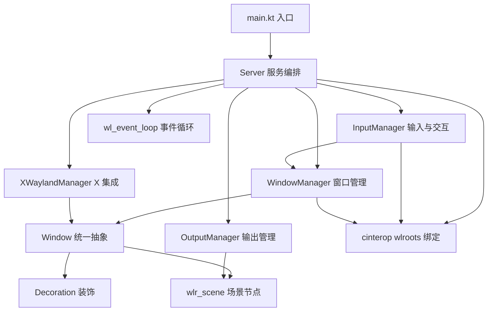

## 用户需求
基于 Kotlin/Native 与系统安装的 wlroots，开发一个可运行的 Wayland 混成器，采用堆叠/浮动优先的窗口范式（类似 GNOME/KDE），具备核心窗口管理、窗口装饰与 XWayland 支持，且依赖通过 cinterop 绑定系统头文件。

## 产品概述
一个在 Linux 上运行的 Wayland 混成器/窗口管理器外壳，负责管理显示器输出、原生 Wayland 窗口与 X11 窗口；窗口以自由浮动态叠加显示，用户可通过键盘与鼠标完成焦点切换、移动、缩放等日常桌面交互，并借助 XWayland 兼容传统 X11 应用。

## 核心功能
- 显示器输出（Output）管理与基础场景渲染。
- 原生 Wayland 窗口（XDG shell）的创建、销毁与场景树挂载。
- 全局堆叠顺序维护、窗口激活与焦点切换。
- 浮动窗口的鼠标拖拽移动与边缘缩放交互。
- 窗口边框与标题栏装饰的绘制及命中测试。
- 键盘/指针输入处理，支持修饰键触发的快捷键。
- XWayland 集成：启动 X 服务、接管 X11 窗口事件并纳入统一窗口管理。


## 技术栈选型
- **Kotlin/Native 2.4.21**：沿用项目现有 `kotlin("multiplatform")` 插件与 `linuxX64` 目标，无需引入新语言。
- **wlroots 0.20.2（系统库）**：经 `pkg-config wlroots-0.20` 验证已安装，库名 `-lwlroots-0.20`，头文件位于 `/usr/include/wlroots-0.20/wlr/`。
- **cinterop**：Kotlin/Native 官方 C 互操作机制，生成 wlroots/wayland/xcb 的 Kotlin 绑定。
- **wlr_scene API**：wlroots 0.18+ 推荐的场景图渲染方式，统一管理输出、图层、节点与损坏区域，避免手写渲染与 damage 跟踪。
- **Gradle 9.9.0 + OpenJDK 21**：现有构建环境，产物为 `linuxX64` 可执行文件。
- 辅助系统库：wayland-server 1.26.0、wayland-protocols 1.50、xcb 1.17.0、xkbcommon、pixman、libdrm（均已具备）。

## 实现思路
采用「C 绑定层 → 服务端核心 → 领域对象 → 入口」的分层结构。先用 cinterop 暴露 wlroots/wayland 类型，并辅以极小的 C shim 封装无法绑定的宏与内联函数；再以 `wlr_scene` 构建输出与图层，用事件循环（`wl_event_loop`）驱动；随后把 XDG 与 XWayland 两类窗口统一抽象为 `Window`，由 `WindowManager` 维护堆叠、焦点与装饰，`InputManager` 负责键鼠与拖拽/缩放状态机。

**关键决策与权衡**：
- 选 `wlr_scene` 而非手写渲染：以少量场景节点开销换取大幅简化的输出管理与自动损坏处理，符合 KISS 且更可靠。
- 用统一 `Window` 抽象屏蔽 XDG/XWayland 差异：避免窗口管理与输入层出现分支重复，提升可扩展性。
- 用 C shim 而非重命名整个头文件：仅封装 `wl_signal_add`、`wl_container_of` 等宏/内联函数，改动面最小；若直接绑定可行则删减 shim。
- 事件驱动无轮询：空闲时零 CPU，交互延迟取决于事件循环派发。

**性能与可靠性**：事件回调为热路径，需避免在其中分配大对象或使用 `StableRef` 造成泄漏；场景图更新为增量式（仅变更节点）。主要瓶颈在软件渲染多输出场景，借助 `wlr_scene` 的组合与按需重绘缓解。

## 实现要点
- `.def` 文件须显式写 `compilerOpts = -I/usr/include/wlroots-0.20 -I/usr/include/pixman-1 -I/usr/include/libdrm`；`linkerOpts` 含 `-lwlroots-0.20 -lwayland-server -lxcb -lxkbcommon -lpixman-1`；C shim 与 def 同目录并加入编译。
- 注意 pkg-config 名称带版本后缀（`wlroots-0.20` 而非 `wlroots`），不要套用旧版（0.16/0.17）教程 API。
- C 回调统一通过 `CFunction` + `StableRef` 注册，并在窗口/输出销毁时 `dispose`，防止悬垂引用。
- 输入快捷键（如修饰键+方向键切焦点、+拖拽切移动）采用集中映射，命中测试与交互模式用状态机表达，避免散落 `if`。
- 仅用现有日志输出（stdout/stderr）记录启动失败与关键错误，不打印事件洪流或敏感环境信息。
- 保持向后兼容：空 `main` 仅替换为启动流程，不改动 `settings.gradle.kts`/`gradle.properties` 既定约定；验证以 `./gradlew build` 编译通过为准，运行验证需 TTY/图形会话，单独说明不混同。

## 架构设计


## 目录结构
```
/home/monika/IdeaProjects/EgolandWM/
├── build.gradle.kts                                   # [MODIFY] 在 linuxX64 中增加 cinterops 配置，注册 wlroots defFile、includeDirs、compilerOpts、linkerOpts。
├── src/linuxMain/
│   ├── cinterop/
│   │   ├── wlroots.def                                # [NEW] cinterop 定义：声明所需 wlr/*、wayland-server、xcb 头文件，headerFilter 与编译/链接参数，链接 C shim。
│   │   ├── wlr_helpers.h                              # [NEW] C shim 头文件：声明 wl_signal_add、容器取值等宏/内联函数的包装函数。
│   │   └── wlr_helpers.c                              # [NEW] C shim 实现：调用 headers 中的静态内联函数，供 Kotlin 侧稳定绑定。
│   └── kotlin/reverie/egoland/
│       ├── main.kt                                    # [MODIFY] 实现程序入口：创建并启动 Server，解析必要环境参数，处理启动失败退出。
│       ├── Server.kt                                  # [NEW] 服务编排：初始化 display/backend/renderer/allocator/scene，注册输出/输入/shell/XWayland，运行事件循环并清理资源。
│       ├── OutputManager.kt                           # [NEW] 输出管理：监听 new_output/destroy，创建 wlr_scene_output，处理帧回调与输出提交。
│       ├── Window.kt                                  # [NEW] 统一窗口抽象：封装 XDG 与 XWayland surface 的公共属性（场景节点、几何、映射态、表面、类型），提供激活/关闭/重配置统一接口。
│       ├── WindowManager.kt                           # [NEW] 窗口管理：维护堆叠链表与焦点窗口，处理 map/unmap/request 事件，协调装饰节点与层级提升。
│       ├── Decoration.kt                              # [NEW] 窗口装饰：创建边框与标题栏场景节点，实现标题文本与活动/非活动配色，提供命中测试判断拖拽/缩放区域。
│       ├── InputManager.kt                            # [NEW] 输入与交互：配置 seat/cursor/keyboard，处理键鼠事件、修饰键快捷键，实现“普通/移动/缩放”交互状态机并驱动焦点与堆叠更新。
│       └── XWaylandManager.kt                         # [NEW] XWayland 集成：创建 wlr_xwayland，监听新 surface 与 ready 事件，转换为统一 Window 并接入窗口管理与输入焦点。
```

## 关键数据结构（设计层约定）
- `Window`：统一抽象，区分 `Xdg` 与 `XWayland` 两种来源，暴露场景节点、几何矩形、映射态、表面引用，以及 `activate()`/`close()`/`configure(x, y, w, h)` 等统一能力；屏蔽两类 shell 的差异，供 WindowManager 与 InputManager 无差别使用。
- 交互状态：以 `None / Move(窗口, 起始坐标) / Resize(窗口, 边方向, 起始几何)` 表达，避免布尔标志组合导致的状态爆炸。


## Agent Extensions
### SubAgent
- **code-explorer**
  - Purpose：深入探查系统已安装的 wlroots 0.20.2 头文件（`/usr/include/wlroots-0.20/wlr/`）及 wayland-server、xcb 相关头文件，提取 cinterop 所需的确切函数签名、宏与结构体定义。
  - Expected outcome：产出精确的 `.def` 头文件清单、include/link 参数，以及因宏/内联函数而必须由 C shim 封装的函数列表，从而最大化 cinterop 首次编译成功率。
